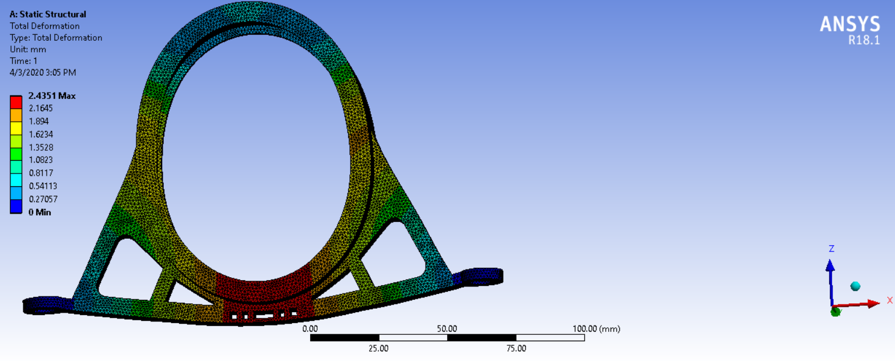
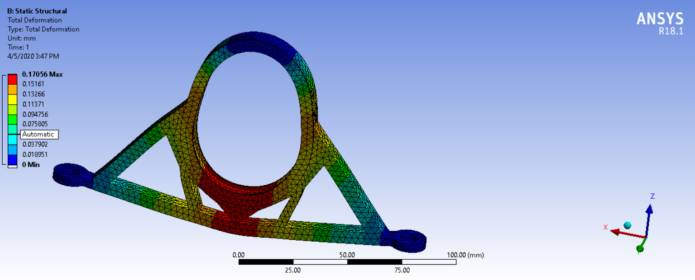
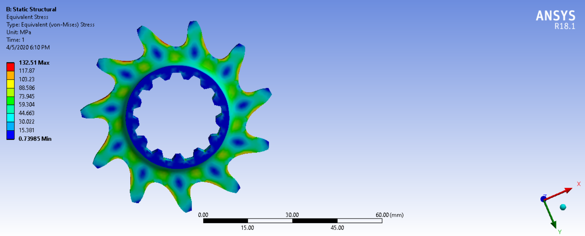
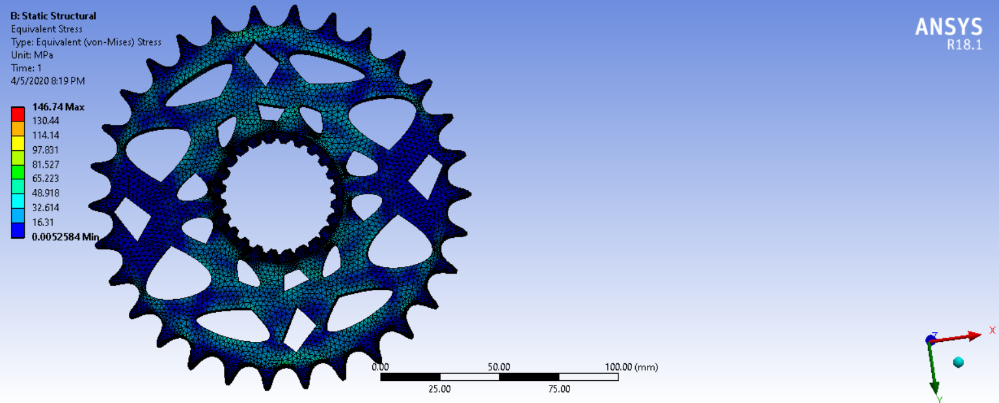

# Chain-drive drivetrain design study

**Formula Manipal (Formula Student), April 2020 · CATIA V5, ANSYS Mechanical R18.1, Excel**

My first complete design task in the transmission subsystem: size and check the parts that carry engine torque from the gearbox output to the rear wheels of the combustion car. That meant the differential mounts, the final drive (chain and sprockets) and the half shafts. I did this as a first-year member, and it is the work that taught me the loop of hand calculation, CAD, FEA and material choice.

## 1. Loads

Everything downstream of the engine is sized from one number, the peak torque at the differential:

```
T_diff = T_engine × primary reduction × first gear × final drive × safety factor
       = 54 Nm × 2.111 × 2.75 × 2.73 × 1.25 ≈ 1070 Nm
```

The chain pulls on the driven sprocket (pitch diameter 151.9 mm) with a tension of about 14.1 kN. The sprocket sits off-centre between the two differential mounts, 29 mm from the left mount and 209 mm from the right one, so a moment balance puts most of the chain load on the left mount:

| | Left mount | Right mount |
|---|---|---|
| Along the chain (X) | 16.1 kN | 2.2 kN |
| Vertical (Z) | 2.8 kN | 0.4 kN |

I set this up as a spreadsheet so that the loads update when the gearing, the chain angle or the mount positions change.

## 2. Differential mounts

The two mounts were modelled in CATIA and checked in ANSYS static structural, with the bearing seat loaded by the forces above and the chassis tabs fixed. The geometry went through three iterations to remove material from lightly stressed regions.

| | Left mount | Right mount |
|---|---|---|
| Max. von Mises stress | 303 MPa | 339 MPa |
| Max. deformation | 2.43 mm | 0.17 mm |
| Mass | 145 g | 73 g |
| Material | Al 7075-T6 | Al 7075-T6 |

Al 6061-T6 was ruled out because the stresses exceed its strength of about 276 MPa.




## 3. Final drive

**Why a chain.** The distance between gearbox output and differential is too long for a direct gear stage without idler gears, a belt would slip at this torque, and a shaft drive does not fit the transverse engine layout. A chain is light, cheap, easy to make and loses only a few percent.

**Chain and sprockets.** DID 520 ERV3 X-ring chain (pitch 15.875 mm), 11-tooth driving and 30-tooth driven sprocket, which gives the final drive ratio of 2.73 from the lap-time study. Eleven teeth is the practical minimum for manufacturing and strength, and the odd/even tooth pairing spreads wear. I generated the tooth profile from the standard sprocket relations in a spreadsheet before modelling it.

| | Driving sprocket (11T) | Driven sprocket (30T) |
|---|---|---|
| Max. von Mises stress | 133 MPa | 147 MPa |
| Max. deformation | 0.013 mm | 0.097 mm |




## 4. Half shafts

The half shafts see almost pure torsion. For a hollow shaft, shear stress and twist follow from the polar moment of area:

```
τ = T·r / J        θ = T·L / (G·J)        J = π/32 · (D⁴ − d⁴)
```

Because the differential is off-centre, the left and right shafts have different lengths (357 mm and 398 mm). I tabulated mass, shear stress and twist angle for a range of bore diameters to find a pair of shafts that is light but twists by nearly the same angle on both sides, so that torque reaches both wheels evenly. Titanium Grade 5 was preferred over AISI 4340 steel: similar shear strength at roughly 60 % of the density.

Selected configuration: 19 × 9 mm for the short shaft and 20.2 × 12 mm for the long one, shear stress 406 and 366 MPa against a 550 MPa limit, twist angles within about one degree of each other.

## What I would do differently now

- The FEA results are single runs without a mesh convergence check, and the peak stresses sit at sharp corners, so the numbers are indicative.
- Only the static peak load was checked. A chain drive loads these parts cyclically, so a fatigue check belongs here.
- The left mount's 2.4 mm deflection would misalign the chain and deserved a stiffness target of its own.
