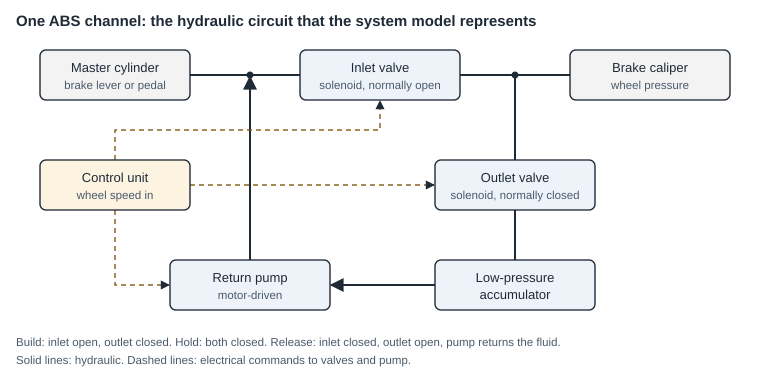

# Product development at Suprajit Engineering

**Engineering Intern, 01/2023 – 07/2023 · Systems Engineer, 07/2023 – 08/2025 · Bengaluru, India**

Suprajit Engineering is an automotive Tier-1 supplier. I worked in product development on actuators, sensors and an ABS unit. The work belongs to the company and its customers, so these pages describe what I did and how, without company drawings, data or results. The diagrams are generic schematics drawn for these pages with AI assistance.

## Case studies

| Case study | What it covers |
|---|---|
| [Electronic steering-lock actuator](steering-lock-actuator.md) | Benchmarking, motor and gear sizing, strength calculations, position sensing, DVP tests |
| [Electronic throttle: structural analysis and test fixture](throttle-analysis-and-fixture.md) | Load cases for a plastic housing at two temperatures, design changes, a bench fixture in CATIA |
| [Optical throttle position sensor](optical-throttle-sensor.md) | Survey of sensing principles, concept, model and lab tests, patent filing |

## ABS hydraulic unit

*Schematic drawn for this page with AI assistance. Textbook circuit, not a company drawing.*

- **Concept.** Benchmarked competitor ABS units and contributed to the concept design.
- **System model.** Modelled the behaviour of the ABS system in MATLAB/Simulink and used the model to compare valve concepts for controlling hydraulic pressure.
- **Electromagnetics.** Simulated the solenoid valves in ANSYS Maxwell to evaluate their magnetic performance.
- **Hydraulics.** Oversaw CFD studies of hydraulic-unit designs in ANSYS Fluent and supported the first feasibility tests.

## Tools

MATLAB/Simulink · ANSYS Maxwell · ANSYS Fluent · ANSYS Mechanical · CATIA V5 · SolidWorks · AutoCAD
