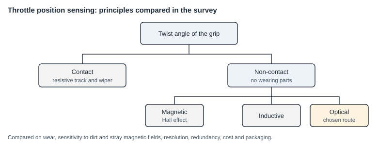

# Optical throttle position sensor (patent filing)

**Suprajit Engineering · 2023 – 2025**

The mechanism is the subject of a patent application filed by the company, so it is not described here. This page covers the problem and my part in the work.

## The problem

An electronic throttle has no cable. A sensor measures the twist angle of the grip and the controller turns it into a motor command. A wrong or drifting signal is a safety problem, so the sensor has to be accurate over its whole life.

*Schematic drawn for this page with AI assistance.*

- **Contact sensors** use a wiper on a resistive track. They are simple and cheap, but they wear.
- **Magnetic sensors** are the usual non-contact choice. They need a magnet and can be disturbed by stray magnetic fields.
- **Optical sensing** has no wearing parts and is not affected by magnetic fields, but it has to cope with dirt and ambient light.

## What I did

- **Survey.** Compared the sensing principles that were feasible for an electronic throttle.
- **Concept.** Conceived an optical, contact-free mechanism for sensing the throttle position.
- **Model.** Modelled the sensor response.
- **Test.** Tested its accuracy in the lab.
- **Integration.** Worked with the validation team on integrating it into the product.

The company filed a patent on the mechanism.
