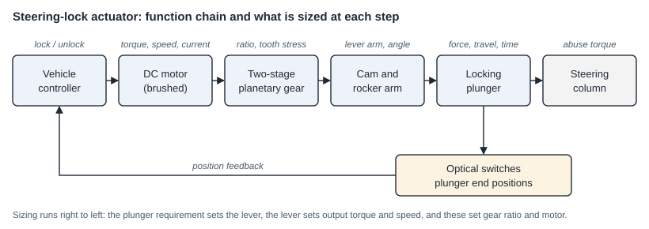

# Electronic steering-lock actuator

**Suprajit Engineering · Engineering Intern, 01/2023 – 07/2023 · SolidWorks, ANSYS Mechanical, Excel**

This page describes the method. The design, its numbers and the customer belong to the company, so none of them appear here.

## The task

An electric two-wheeler locks its steering electronically. On command, a small motor drives a plunger into the steering column; on the next command it pulls the plunger out again. The actuator has to deliver a set force over a set travel within a set time, fit into a small package, stay within a current limit, and survive someone forcing the handlebar against the locked column.

*Schematic drawn for this page with AI assistance. Generic illustration, not a company drawing.*

## What I did

- **Benchmarking.** Took apart lock and latch actuators from production scooters and compared them with catalogue actuators: motor type, gear train, return spring, overload protection, how the housing is closed.
- **Sizing from the requirement backwards.** Plunger force, travel and actuation time give the lever arm and the output torque and speed. From there I compared candidate motors on rated and stall torque, speed and current, and derived the gear ratio each one would need.
- **Gear stage.** Chose tooth counts for a two-stage planetary gear to reach the ratio, and checked tooth bending and contact stress with the AGMA method to select the material for the small gears.
- **Strength.** The governing case for the plunger is not operation but abuse: a torque on the handlebar while the column is locked. I calculated the plunger stress for this case, the friction forces the motor has to overcome when the column presses on the plunger, and the snap-fits of the housing. Load-carrying parts were checked by FEA in ANSYS Mechanical.
- **Position sensing.** Integrated optical switches that report the two end positions of the plunger to the controller.
- **Verification.** Ran design-verification (DVP) tests on the first prototypes and assessed durability and compliance.

The same motor and gear calculations were also used to assess a seat-latch actuator.

## What I took from it

- Start from the requirement at the output and work back to the motor. Starting from an available motor leads to a gear train that fits nothing.
- The abuse load is far above the operating load, so it decides the plunger and its guide, while the operating load decides motor and gears.
- A calculation sheet that states every input, source and formula is worth more in a design review than a result.
