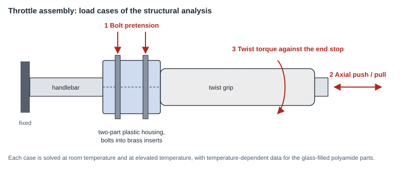

# Electronic throttle: structural analysis and test fixture

**Suprajit Engineering · 2023 · ANSYS Mechanical, CATIA V5**

This page describes the method. Geometry, loads and results belong to the company and its customer, so none of them appear here.

## Structural analysis

An electronic throttle for a two-wheeler is a twist grip in a two-part plastic housing that is clamped to the handlebar by bolts running into brass inserts. The housing parts are glass-filled polyamide. The question was whether the assembly survives assembly and misuse loads, both cold and hot.

*Schematic drawn for this page with AI assistance. Generic illustration, not a company drawing.*

How the analysis was set up:

- **Three load cases:** bolt pretension, an axial push and pull on the grip, and a twist torque against the end stop.
- **Two temperatures.** Glass-filled polyamide loses most of its stiffness and strength when hot, so each case was solved with material data for room temperature and for elevated temperature. Stress was the criterion when cold, strain when hot.
- **Contacts with friction** between all touching parts, and the bolt pretension applied as the first load step.

My part:

- **Wrote the requirements for the analysis report:** which parts, material data and assumptions, mesh type and quality, contacts and boundary conditions, load locations, and which plots and animations have to be delivered.
- **Prepared the load cases and material data** for the analysis request. The full assembly analysis was run by an external analysis supplier.
- **Reviewed the results** and raised queries on them.
- **Ran my own static analyses** of the housing parts in ANSYS Mechanical and proposed design changes from them: fillets in place of sharp chamfer ends at the stress concentrations, thicker walls with less hollow volume, and reshaped supports.

## Test fixture

To record the sensor output against twist angle, the throttle has to be held and turned in a repeatable way.

- **Design.** A bench fixture in CATIA V5: a support cylinder stands in for the handlebar, a gripper holds the twist grip, and a pointer runs over a degree scale.
- **Concepts.** Two concepts were modelled; one was taken to manufacturing.
- **Manufacturing data.** 2D drawings and DXF files for the sheet-metal parts, drawings for the turned parts, and STEP data for the 3D-printed parts.

## What I took from it

- For plastic parts the temperature decides the result. An analysis at room temperature alone would have passed a design that fails hot.
- Specifying what an analysis report must contain before the work starts saves a review loop afterwards.
